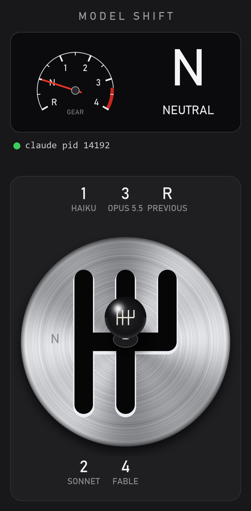

# gearbox
<p align="center"></p>

Six-speed H-pattern shifter that switches the model of a running Claude Code session by typing `/model <id>` into its tmux pane.

## Setup (WSL Ubuntu or any Linux/macOS with tmux)

```sh
sudo apt install tmux python3-pip pipx
pipx install .                       # gives the `gearbox` command
mkdir -p ~/.config/gearbox && cp statusline.py ~/.config/gearbox/ && chmod +x ~/.config/gearbox/statusline.py
chmod +x gearbox-tmux.sh
```

Add to `~/.claude/settings.json` (status line shows the gear; hooks tell the shifter when Claude is busy):

```json
{
  "statusLine": { "type": "command", "command": "~/.config/gearbox/statusline.py" },
  "hooks": {
    "UserPromptSubmit": [{ "hooks": [{ "type": "command", "command": "touch ~/.config/gearbox/busy" }] }],
    "Stop": [{ "hooks": [{ "type": "command", "command": "rm -f ~/.config/gearbox/busy" }] }]
  }
}
```

Without the hooks, the shifter sees Claude as always idle and sends immediately.

## Run

```sh
./gearbox-tmux.sh           # Claude Code left, shifter right
gearbox --target %3         # or by hand, next to an existing Claude pane
```

Windows without tmux: `gearbox --target <claude.exe PID>` (or let it auto-detect the newest interactive `claude.exe`). It writes `/model <id>` + Enter straight into that session's console input, no focus stealing.

## Windows app: gearshift-cc

A desktop window with a tachometer, a gear readout and a brushed-metal gate with a ball knob. Same keys, mouse and config as the terminal version.

```powershell
pip install -e .                                   # pillow, numpy, textual
powershell -ExecutionPolicy Bypass -File install-shortcut.ps1   # Desktop + Start menu icon
```

Open Claude Code first, then click **gearshift-cc**. It finds the running `claude.exe` itself. Or run `pythonw -m gearbox.gui --target <PID>`.

## Keys

| Key | Action |
| --- | --- |
| mouse drag | grab the knob and shift; it only slides along the gate |
| arrows / `hjkl` | move the knob along the gate |
| `1`-`6`, `r`, `n` | jump to a gear (animated through neutral) |
| `a` | assign gears (model id, `/command`, or blank) |
| `s` | send a queued shift now, even if Claude looks busy |
| `c` | copy the last command (`format`: `slash` or `tmux`) |
| `m` | mute the bell |
| `q` | quit |

## Config

`~/.config/gearbox/config.json`, created on first run and hot-reloaded: `target`, `format`, `sendWhen` (`idle`/`now`), `sound`, `reducedMotion`, `gears`. Invalid edits show an error and keep the last good config.

## Test

```sh
python test_gearbox.py
```

Before pointing it at Claude, smoke-test the bridge against a pane running `cat`: `gearbox --target <that pane id>`, then shift.
